# 2D판 증거 표 — 안 본 사람 시험(goal §9-7 · 11-02)

영화 줄거리 28장면(`reference.md` A)마다 게임 안에서 그 장면을 전하는 순간을 짚었다. 대사가 화면(대화창·말풍선)에 뜬 때의 사진과 그 줄이다. 보통 봇이 그 차례를 실제로 놀다가 그 글이 떴을 때 찍었다(`tools/harness/drg2d_evidence.cjs` · 사진은 683×384).

**짚힌 장면 28/28 (100%)** — 목표 90%

| # | 영화 장면 | 차례 | 게임 안 대사 | 사진 |
|---|---|---|---|---|
| 1 | 버크 소개 | 1-1 | 「여기는 버크. 바다 한가운데 바람 센 섬 마을이야.」 | 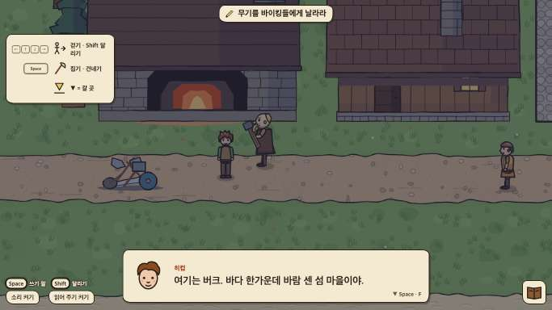 |
| 2 | 밤 습격 · 나이트 퓨리 휘파람 | 1-5 | 「나이트 퓨리… 아무도 본 적이 없대. 바다에 비친 별을 가린대.」 | 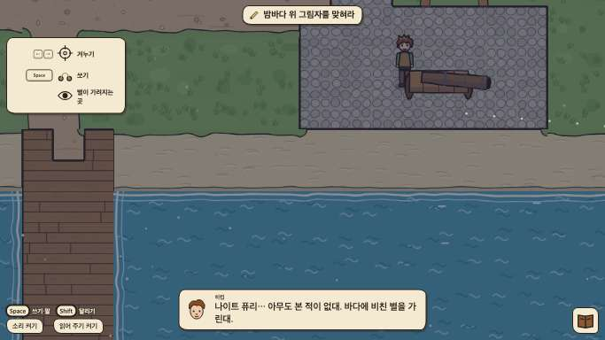 |
| 3 | 볼라로 맞힘 · 아무도 안 믿음 | 1-6 | 「그만. 드래곤 하나 잡겠다고 마을을 다 흔들었구나.」 | 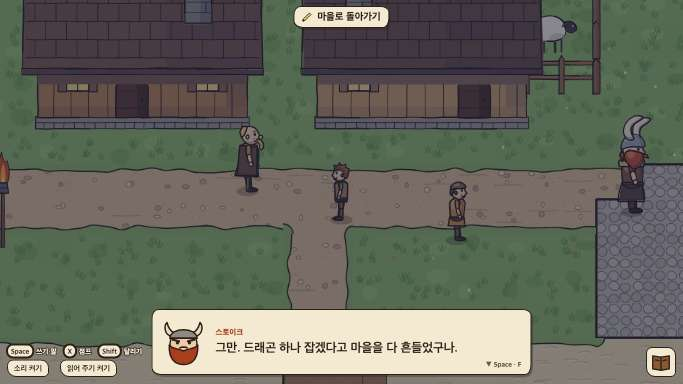 |
| 4 | 숲에서 밧줄을 끊어 줌 | 2-3 | 「…날 덮쳤는데, 해치지 않았어.」 | 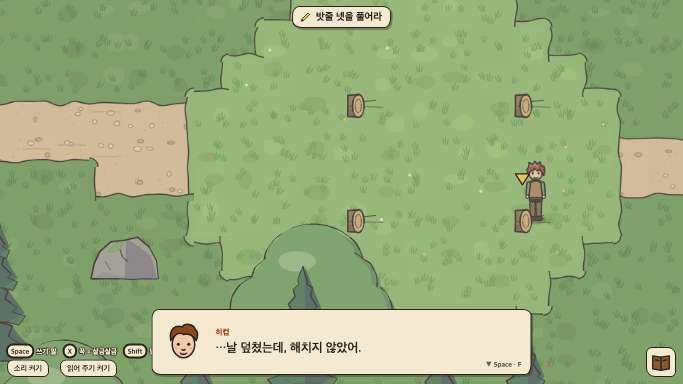 |
| 5 | 훈련 1일 그롱클 | 3-1 | 「그롱클은 여섯 발! 내가 셀게!」 | 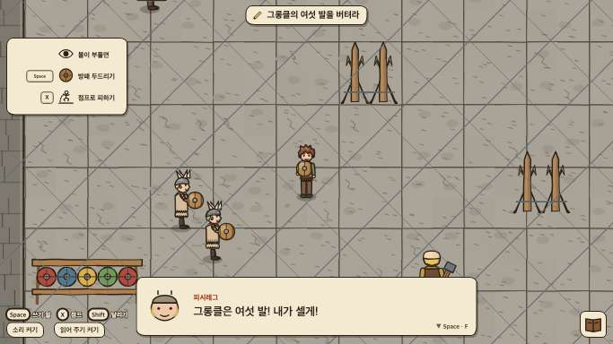 |
| 6 | 코브(왼 꼬리날개 없음) | 3-2 | 「왼쪽 꼬리날개가 없어. 숲에서 주운 조각이 바로 그거야.」 | 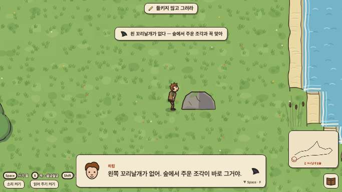 |
| 7 | 드래곤 책('알 수 없음') | 3-3 | 「나이트 퓨리… 알 수 없음? 그럼 내가 그려 넣을래.」 | 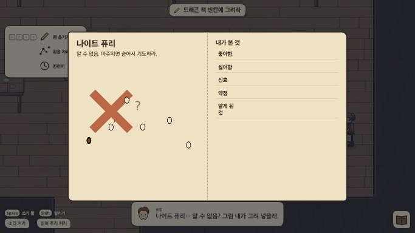 |
| 8 | 훈련 2일 내더 | 4-0 | 「훈련 둘째 날! 내더는 빠르고 가시를 쏜다.」 | 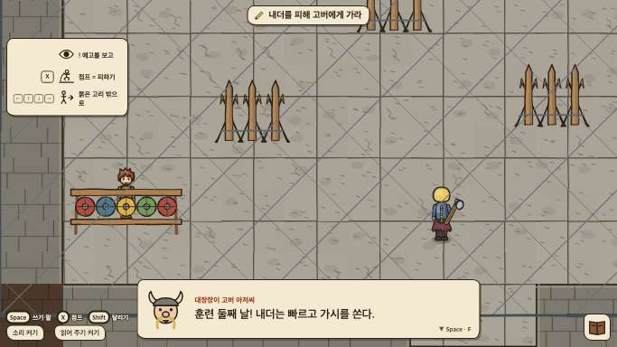 |
| 9 | 생선 · 이름 · 나눠 먹기 | 4-2 | 「이가 없는 줄 알았는데… 투슬리스! 이게 네 이름이야.」 | 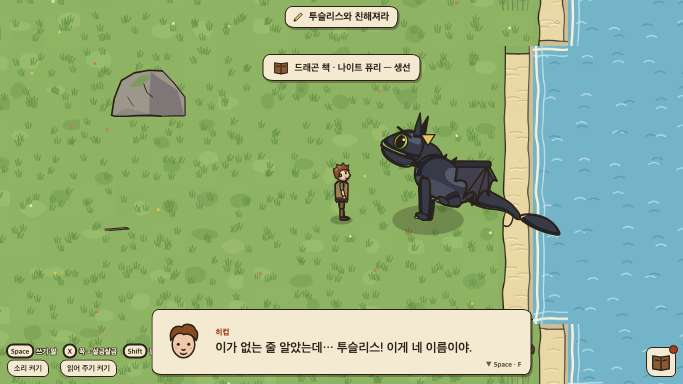 |
| 10 | 모래 그림 · 손 닿기 | 4-3 | 「그래도 손바닥에 코를 댔어. 이제 날 믿기 시작한 거야.」 | 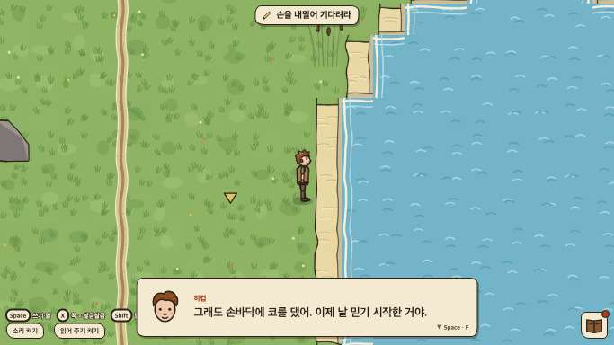 |
| 11 | 꼬리날개 첫 시험 · 뱀장어 질겁 | 5-2 | 「뱀장어를 보고 질겁했어! 드래곤은 뱀장어를 싫어하는구나.」 | 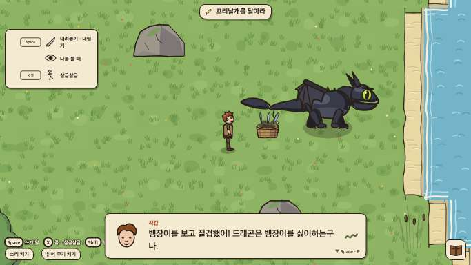 |
| 12 | 지플백 · 뱀장어로 몰아넣음 | 5-4 | 「그리고… 이것도.」 | 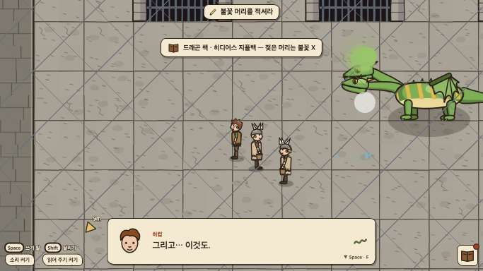 |
| 13 | 안장 · 드래곤 풀 · 턱 긁기 · 빛 | 6-1 | 「드래곤 풀에 뒹굴고, 턱 밑을 긁으면 털썩, 빛 점은 쫓아가!」 | 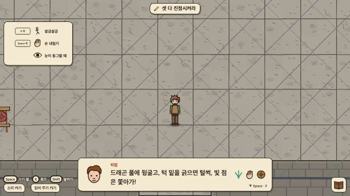 |
| 14 | 스토이크 귀환(들킬 뻔) | 7-1 | 「다 들었다. 이제 숨길 것 없다.」 | 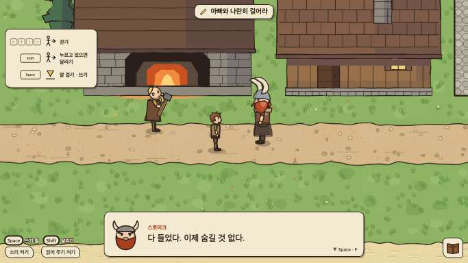 |
| 15 | 안장 비행 · 쪽지 날아감 · 돌기둥 | 6-2 | 「앗, 쪽지가! …괜찮아, 감으로 가자!」 | 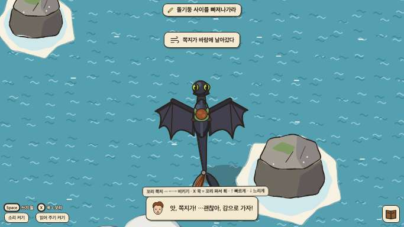 |
| 16 | 테러 점심 → '책이 다 틀렸다' | 6-3 | 「드래곤 책이 다 틀렸어. 이제 내가 본 대로 고쳐 쓸 거야.」 | 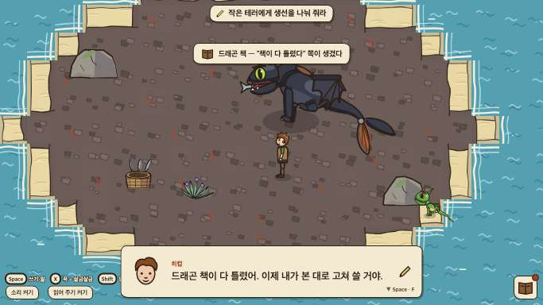 |
| 17 | 투구 선물 | 7-1 | 「네 엄마 가슴판 반쪽으로 만든 투구야.」 | 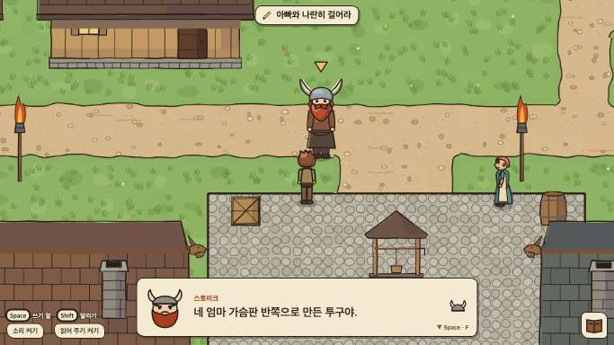 |
| 18 | 최종 선발 | 7-2 | 「1등은 히컵! 내일 마지막 시험은 히컵이 치른다!」 | 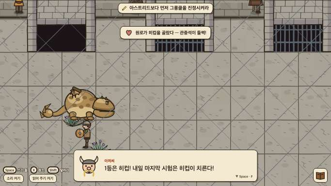 |
| 19 | 아스트리드 · 무서운 비행 · 사과 · 구름 위 | 8-2 | 「…아까는 미안해. 네가 몰래 떠나려는 줄 알고 화가 났어.」 | 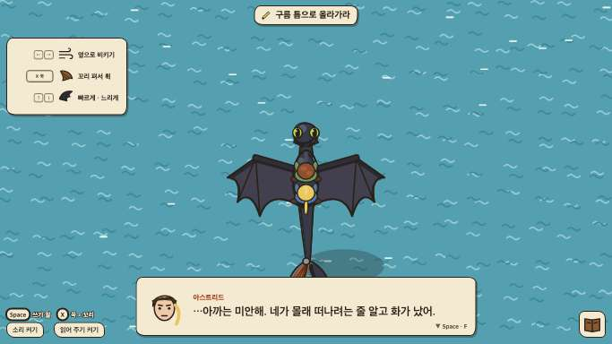 |
| 20 | 둥지 · 대장 · 그롱클이 먹힘 | 8-4 | 「그럼 나쁜 건 대장뿐이네. 다른 애들은 겁먹었을 뿐이야.」 | 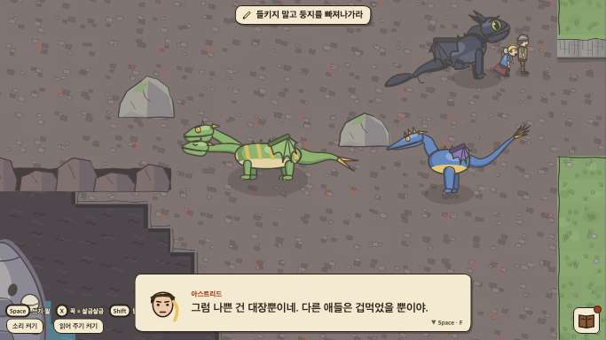 |
| 21 | 마지막 시험 · 무기·투구 · 투슬리스 잡힘 | 9-1 | 「(드래곤을 해치지 않아도 된다는 걸.)」 | 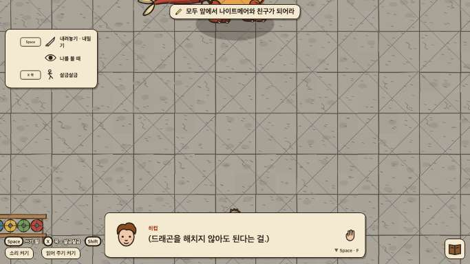 |
| 22 | 말실수 · 의절 · 사슬에 묶여 출항 | 9-4 | 「그 나이트 퓨리를 길잡이로 삼겠다. 둥지까지 끌고 간다!」 | 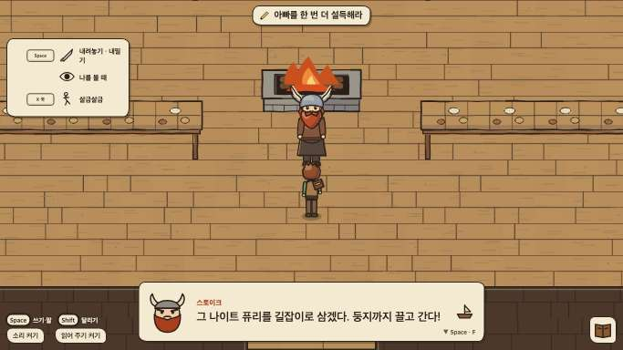 |
| 23 | 친구들에게 드래곤 · 출격 | 9-6 | 「가자! 둥지로 — 투슬리스를 구하러!」 | 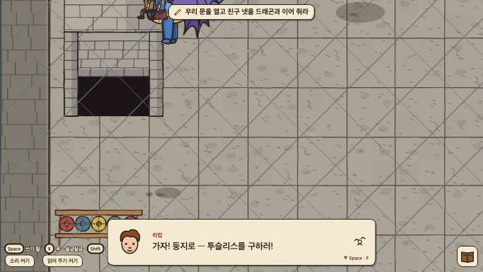 |
| 24 | 둥지 공격 · 대장 등장 · 배가 탐 | 10-1 | 「둥지 섬이야! 어른들 배가… 불타고 있어!」 | 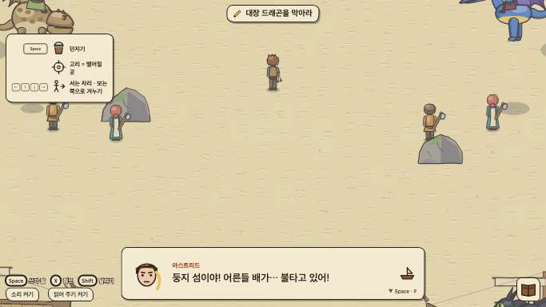 |
| 25 | 역할 나누기 | 10-1 | 「다들 맡을 일을 나누자! 나는 볼라로 대장 눈을 맞힐게.」 | 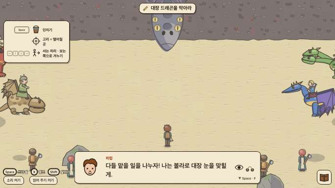 |
| 26 | 물속 사슬 · 스토이크의 구조와 사과 | 10-2 | 「내가 틀렸다. 넌 내 자랑이야.」 | 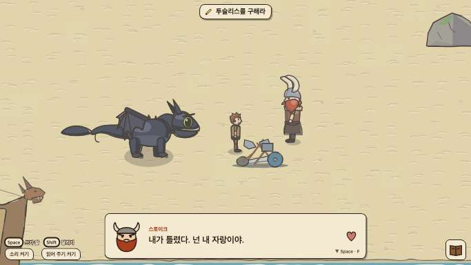 |
| 27 | 구름 · 날개 구멍 · 입 안 · 꼬리날개 불 · 감쌈 | 10-5 | 「고맙다. 내 아들을 지켜 줘서.」 | 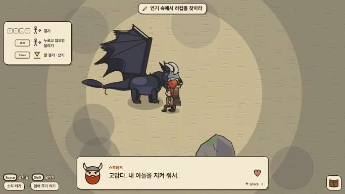 |
| 28 | 의족 · 새 꼬리날개 · 함께 사는 마을 · 끝 내레이션 | 11-3 | 「우리는 서로의 빈 곳을 채워 주는 친구야.」 | 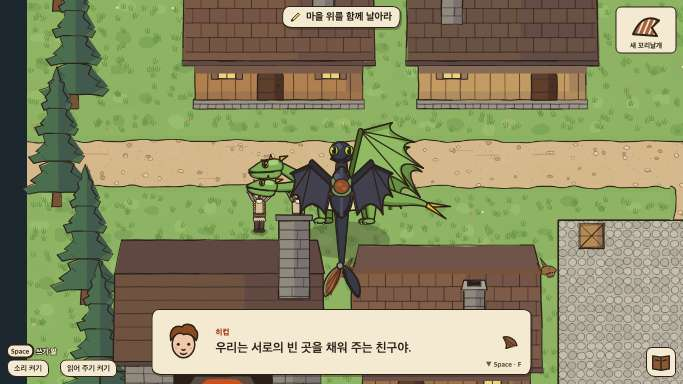 |

- 다시 찍기: `B1_MAIN=1 zsh tools/ops/b2.sh node tools/harness/drg2d_evidence.cjs . --out=docs/dragon/shots2d`
- 장 카드(장 시작 = 지난 이야기 셋 · 장 끝 = 무엇이 바뀌었나)는 이 표 밖의 덤이다 — `dragon2d/js/story/recap.js`
